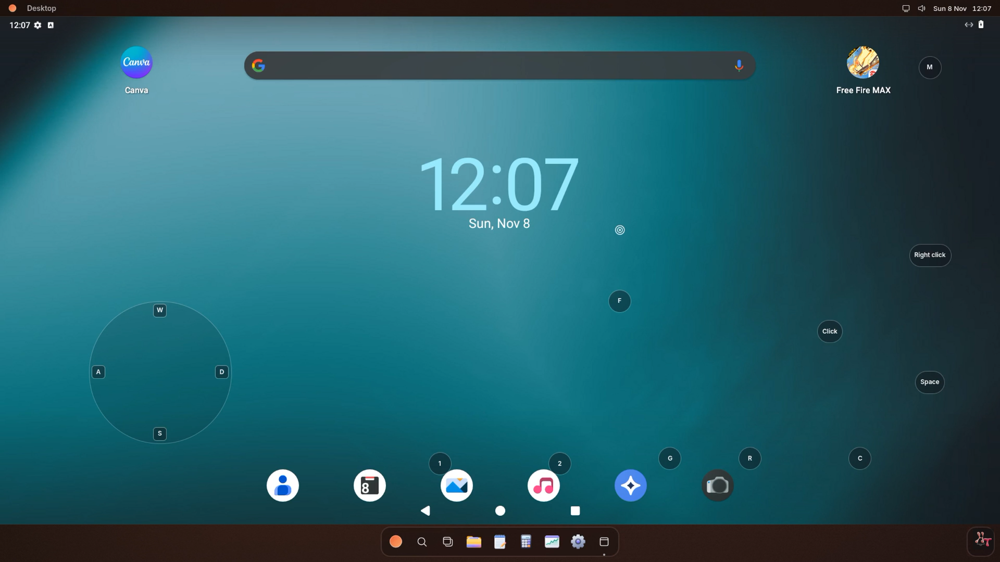
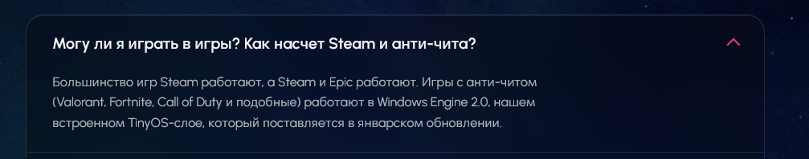
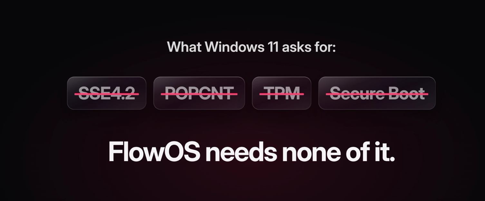
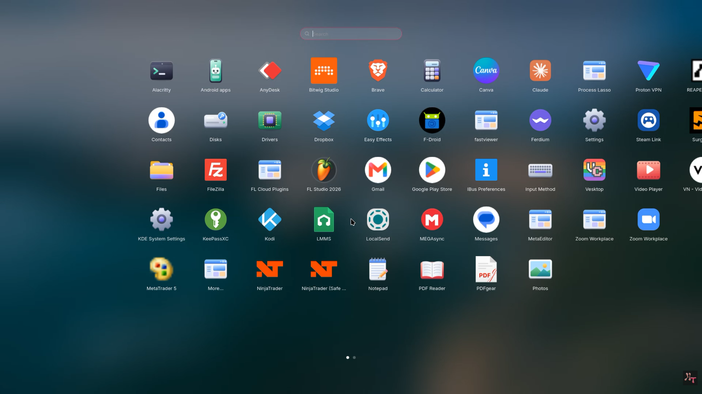
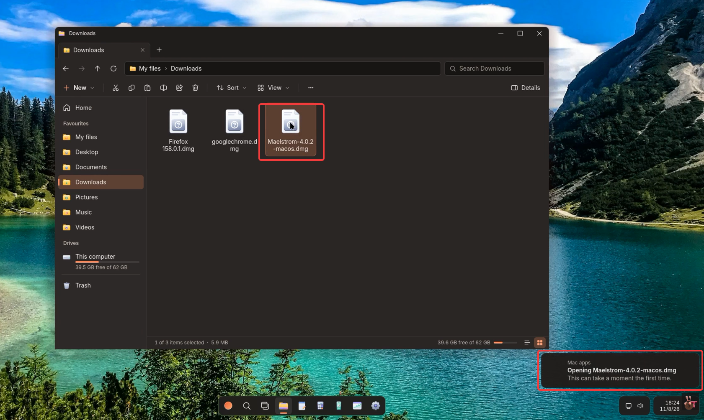
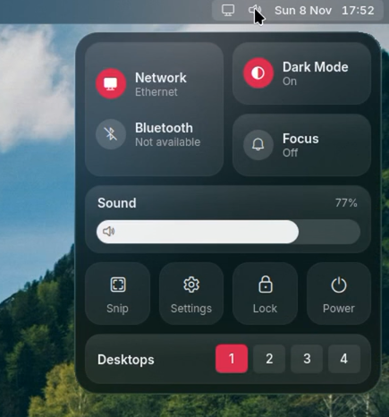

**1. «Инновационная**» интеграция **Windows, macOS** и **Android**  

Разработчики заявляют полную нативную поддержку приложений с разных систем **на уровне ядра**. На деле - это ебучий эмулятор, виртуалка, прослойки вроде **Wine/Proton** и **Waydroid**. Никакого «**своего ядра**» там нет. В их же собственных промо-роликах, если присмотреться к Диспетчеру задач, в фоне висят процессы **dbus-broker, at-spi-bus-launcher и baloo_file** (штатный индексатор файлов графической среды KDE).  

**Вывод**: Это просто переделанный и вылизанный дистрибутив Linux (а именно ArchLinux + KDE Plasma), на который натянули тему под Windows 11.  

**2. Android «без эмуляторов**» 

В FAQ и на сайте они нагло пиздят, что не используют эмуляторы для запуска Android-приложений. Но на их же YouTube-канале на футажах с запущенным «Android» видна типичная для эмуляторов (вроде **Waydroid**) фейковая строка состояния с уровнем заряда и дефолтной иконкой сети, которую они даже поленились вырезать.  

**Вывод**: Запуск мобильных приложений идет через стандартный опенсорсный контейнер. Их заявления - фейк и преувеличение.  

**3. Гейминг, EAC и вранье про слабые ПК**

**WindowsEngine 2.0** (релиз якобы в январе 2027) заявляется как инновация и альтернатива Windows. Они обещают поддержку Fortnite и других игр с мощным античитом.  
Но на Linux априори нельзя играть в игры с EAC (Easy Anti-Cheat), если разработчик игры сам не включил поддержку Proton. **Fortnite на Linux не работает** - Epic Games банит за это.  
На видео нам показывают только **CS2** и **Dota 2**.  
_  
Эти игры и так имеют нативные порты под **Linux** и прекрасно там работают без всяких FlowOS. Если они попытаются запустить EAC-игры через виртуальную машину с пробросом GPU, это сожрет в 2-3 раза больше видеопамяти и RAM, а аккаунты юзеров улетят в **пермач**. Как это вписывается в концепцию «ОС для старых и слабых ПК»? Никак.  

**4. Наебательство с потреблением 128 МБ ОЗУ** 

Главный маркетинговый поинт: «Наша ОС потребляет всего 128 МБ». Это самый наглый скам проекта.  

> Во-первых, во вкладке Performance у них светится **VMware SVGA II Adapter**. То есть их «легкая» ОС тестируется внутри виртуальной машины VMware, а не на реальном железе.  

 >Во-вторых, они искусственно выделили виртуалке 128 МБ ОЗУ для красивого скрина, где показана загрузка «94.3 MB (96%)». Но если опустить глаза чуть ниже в их же Диспетчере задач, видно строку «**Committed**» - там занят **1** Гигабайт памяти (**362.7 MB / 1.0 GB**), а файл подкачки (Swap) пашет на полную.  

**Система не работает на 128 мегабайтах** - она задыхается и скидывает всё на жесткий диск. При запуске любой программы из другой ОС (через Wine или Android-контейнер) этот франкенштейн просто зависнет намертво на слабом ПК.  

**5. Закрытый исходный код и Vibecoding** 

Они прикрывают исходный код коммерческой тайной (чтобы собрать бабки на предзаказах). Но реальная причина - они прячут свой «**vibecode**» (код, сгенерированный нейронками). В FAQ они отрицают использование ИИ, но архитектура и код даже самого сайта (landing page и checkout) кричат о том, что всё это собрано промптами через **ChatGPT или Claude**.  

**6. Абсурдные системные требования (SSE4.2, POPCNT, TPM)**  

Маркетинговая плашка «**What Windows 11 asks for... FlowOS needs none of it**» с перечеркнутыми **SSE4.2, POPCNT, TPM и Secure Boot** - это выстрел себе в ногу. 

>**Во-первых, TPM и Secure Boot** действительно не нужны Linux, это правда. Но вот **SSE4.2** и инструкция **POPCNT** - это базовый набор инструкций процессора. **Windows 11** требует их просто потому, что без них современные браузеры и тяжелый софт тупо не запустятся. 

Если они обещают запускать современный софт без SSE4.2, то они либо нагло врут, либо предлагают сидеть в консоли на процессорах 2006 года выпуска. Арчлинуксу, на котором базируется эта поделка, эти инструкции может и не нужны для старта ядра, но любой современный софт из их же магазина их потребует. 

**7. «Свой» магазин приложений и меню**  

>Скриншот с меню приложений и магазином «**Velotic Store**» - это классический **Flathub** (репозиторий пакетов Flatpak для Linux), на который просто натянули свой интерфейс.![[firefox_tgWbgM89nY.png]]
 В магазине прямо написано: «**Free apps from Flathub and their makers**». То есть они даже не скрывают, что берут бесплатный опенсорсный софт, меняют название магазина и продают доступ к этому дистрибутиву за **20** баксов

>Наличие **FL Studio** в меню - это отдельная комедия. FL Studio не имеет нативного порта под Linux. Она запускается исключительно через костыли вроде Wine, и работает там с огромными задержками звука и отваливающимися VST-плагинами.

Обещать полноценную работу FL Studio на слабом железе через эмуляцию - это обман чистой воды  

**8. Фейковый запуск macOS приложений** 

Скриншот с попыткой открыть **.dmg** файлы (образы дисков **macOS**) - это самая нелепая часть их презентации.  
В правом нижнем углу всплывает уведомление: «**Opening Maelstrom-4.0.2-macos.dmg. This can take a moment the first time**».  
Это технически невозможно реализовать нативно.

Чтобы запустить .dmg на Linux, нужно либо использовать **Darling** (прослойку трансляции, которая работает крайне нестабильно и только с консольными утилитами, без GUI), либо поднимать полноценную виртуальную машину **Hackintosh.** Поднятие macOS в виртуалке сожрет **минимум 4-8 ГБ ОЗУ**, что полностью перечеркивает их сказки про 128 МБ потребления.  

**9. Сворованный дизайн и интерфейс**  

Верхний статус-бар (как в **macOS**) и меню быстрых настроек - это стандартные виджеты среды рабочего стола **KDE Plasma** или **GNOME**, кастомизированные сторонними темами (вероятно, что-то вроде **WhiteSur-gtk-theme**). Они просто скачали бесплатные темы оформления с **GitHub**, поменяли пару иконок и выдают это за
"**инновационныйдизайн новой ОС.**"

**10. Юридический скам**:

продажа бесплатного под видом инноваций  
Разработчики **нарушают** главное негласное (а часто и гласное) правило **Open Source**. В слитом исходном коде их сайта (страницы terms и refunds) они пытаются юридически прикрыть свои задницы.

>Они берут бесплатный дистрибутив Linux, бесплатную графическую оболочку KDE, бесплатный магазин Flathub, оборачивают это в фейковую маркетинговую легенду про «революционную ОС и WindowsEngine 2.0» и собирают по $20 за предзаказ цифрового воздуха

**Это прямое введение потребителя в заблуждение** (False Advertising). Вы платите не за ОС, вы платите за то, что школьник-энтузиаст скачал и настроил за вас **бесплатный** ArchLinux, наобещав функционал, которого не существует в природе, и который к тому всему не факт что вы получите.

**11. План действий: Как вернуть деньги и наказать скамеров**  

Если вы один из тех 300+ человек, кто уже закинул им деньги, ваш кэш еще можно спасти, а лавочку - прикрыть. 
**Что нужно делать прямо сейчас**:

>**Chargeback** (Возврат средств):Если оплата шла через **PayPal**, **Patreon** или карту - немедленно открывайте спор (Dispute) в техподдержке с пометкой «**Продукт не соответствует заявленным характеристикам Мошенничество**». Прикладывайте скриншоты их обещаний и того факта, что это виртуалка с Linux. PayPal и Patreon **панически боятся** массовых возвратов и быстро заморозят их счета. 

> **YouTube** Страйки: Переходите на их канал и кидайте репорты на видео. Причина: «**Спам или мошенничество (Scam/Fraud)**». Если YouTube увидит всплеск обоснованных жалоб, канал улетит в теневой бан или получит пермач, перекрыв им приток новых жертв.  

> **Жалоба на хостинг**: Их сайт [flowos.veloticstudios.com](https://flowos.veloticstudios.com) где-то хостится. Массовые абузы регистратору домена за мошенническую деятельность быстро оставят их без красивого лендинга.

**мы TET SEC и мы за правду**

**обновление 18.11.2026**

**12.** Паника и зачистка следов (**Переобувание в воздухе**)  
Изначально в FAQ разработчики агрессивно отрицали использование эмуляторов, скрывали базу Linux и продавали проект как «**совершенно новую операционную систему**». Но как только запахло массовыми разоблачениями, они за ночь переписали сайт, резко став более
«**открытыми**» и пытаясь сделать вид, что всё так и задумывалось. К их несчастью, у нас на руках есть полные архивы их первоначального лендинга и старого FAQ, где задокументирована каждая строчка их изначального вранья. Смена показаний на ходу - это классический маркер мошенников, которые в панике пытаются подстелить соломку от грядущих чарджбеков и страйков.

**бэкап их сайта вы найдете у нас в Telegram канале**

**до новых встреч господа**